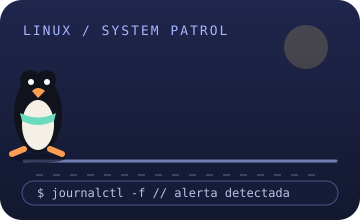
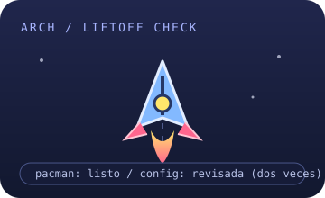

<div align="center">


### Desarrollo web · integración · UX/UI

Construyo aplicaciones web conectando interfaz, servidor y datos.  
Me interesa que funcionen bien por dentro y que se entiendan por fuera.

[LinkedIn](https://www.linkedin.com/in/adriamartinezmorales/) · [Proyectos y experimentos](https://github.com/whiterDJ-adri?tab=repositories)

</div>

---

## 00 / Selección de equipo

Cada misión trae sus propios problemas. Estos tres ya conocen el mapa.

<table>
<tr>
<td align="center" width="33%">
<br />
<strong>TUX / OPS</strong><br />
<sub>Patrulla los logs. Si vuelve con una alerta, abro la terminal.</sub>
</td>
<td align="center" width="33%">
<br />
<strong>ARCH / BOOST</strong><br />
<sub>Revisa la configuración antes del despegue. Dos veces, por si acaso.</sub>
</td>
<td align="center" width="33%">
<br />
<strong>REACT / LOOP</strong><br />
<sub>Cambias un estado y ya está dando otra vuelta.</sub>
</td>
</tr>
</table>

## 01 / Inventario

```ini
[interfaz]
JavaScript = React, Astro
diseño = UX/UI, Figma

[servidor]
runtime = Node.js
framework = Express
integraciones = APIs REST

[datos]
relacional = SQL, MariaDB
documentos = MongoDB

[base de operaciones]
sistema = Linux, Arch
contenedores = Docker
control_de_versiones = Git
```

## 02 / Misiones activas

- Construir funcionalidades web de principio a fin, desde la interfaz hasta los datos.
- Conectar servicios y entender qué ocurre entre una petición y su respuesta.
- Seguir explorando Linux, automatización y buenas formas de resolver problemas.

## 03 / Registro de incidencias

<details>
<summary>Abrir el cuaderno de campo</summary>

```text
BUG-01  “Es un cambio pequeño”
        Alcance real: varios archivos y una búsqueda en la documentación.

BUG-02  “En mi máquina funcionaba”
        Sospechoso habitual: configuración distinta.

PLAN    Leer el error, seguir el rastro y cambiar una cosa cada vez.
```

</details>

---

<div align="center">

¿Tienes una idea, una integración o una API que necesita compañía?

[Conectemos en LinkedIn](https://www.linkedin.com/in/adriamartinezmorales/) · [Explora mis repositorios](https://github.com/whiterDJ-adri?tab=repositories)

</div>
