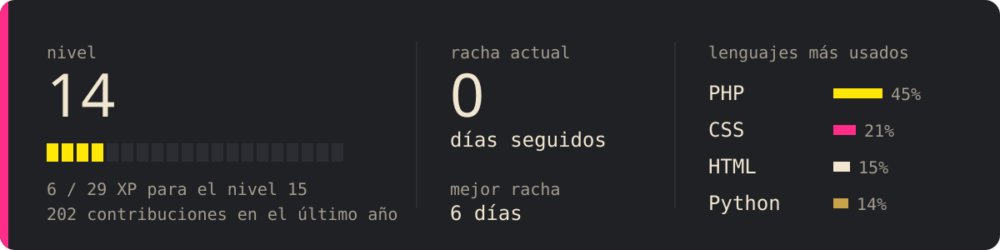
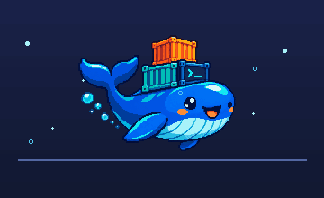

<div align="center">

<a href="https://www.linkedin.com/in/adriamartinezmorales/">
  
</a>

Desarrollo de aplicaciones · integración · UX/UI

Construyo aplicaciones conectando interfaz, lógica, servicios y datos.<br />
Me interesa que funcionen bien por dentro y que se entiendan por fuera.

[LinkedIn](https://www.linkedin.com/in/adriamartinezmorales/) · [Proyectos y experimentos](https://github.com/whiterDJ-adri?tab=repositories)

</div>

## Ficha de personaje

```yaml
clase: desarrollador web
habilidad_pasiva: conectar diseño, interfaz y datos
estilo_de_juego: entender el problema antes de tocar el código
debilidad: "solo voy a cambiar una cosa"
```



## Partidas guardadas

Dos proyectos, dos tipos de misión: uno convierte preguntas en una partida; el otro conecta una Raspberry Pi con una aplicación web.

<table>
<tr>
<td width="50%" valign="top">

### Akineitor

Un juego web que intenta adivinar un personaje de Dragon Ball con preguntas de sí o no. El algoritmo bayesiano elige las preguntas que más información dan y aprende cuando el jugador lo corrige.


**PHP · MySQL · Tailwind · API REST**

[Probar la demo](https://akinator.innovux.es/) · [Ver el repositorio](https://github.com/whiterDJ-adri/akineitor)

</td>
<td width="50%" valign="top">

### Raspberry Pi: ojo al movimiento

Una cámara captura imágenes y las envía a una API para guardarlas y consultarlas desde un panel web. Une código en la Raspberry Pi, backend y base de datos.


**Python · OpenCV · Flask · MongoDB**

[Ver el repositorio](https://github.com/whiterDJ-adri/raspberryPi)

</td>
</tr>
</table>

## Akineitor de bolsillo

<!-- JUEGO:INICIO -->
Piensa en un personaje de Dragon Ball y responde a mis preguntas. La partida es compartida: cualquiera que pase por aquí puede contestar la siguiente.

**Partida 1, paso 1.** ¿Apareció por primera vez como enemigo de Goku?

[**Sí**](https://github.com/whiterDJ-adri/whiterDJ-adri/issues/new?title=akineitor%7Cp1-1%7Csi&body=Pulsa%20%C2%ABCreate%C2%BB%20o%20%C2%ABSubmit%20new%20issue%C2%BB%20para%20enviar%20tu%20respuesta.%20No%20hace%20falta%20escribir%20nada%20m%C3%A1s.%0A%0AEn%20unos%20segundos%20el%20perfil%20mostrar%C3%A1%20la%20siguiente%20pregunta.) · [**No**](https://github.com/whiterDJ-adri/whiterDJ-adri/issues/new?title=akineitor%7Cp1-1%7Cno&body=Pulsa%20%C2%ABCreate%C2%BB%20o%20%C2%ABSubmit%20new%20issue%C2%BB%20para%20enviar%20tu%20respuesta.%20No%20hace%20falta%20escribir%20nada%20m%C3%A1s.%0A%0AEn%20unos%20segundos%20el%20perfil%20mostrar%C3%A1%20la%20siguiente%20pregunta.) · [**No lo sé**](https://github.com/whiterDJ-adri/whiterDJ-adri/issues/new?title=akineitor%7Cp1-1%7Cnose&body=Pulsa%20%C2%ABCreate%C2%BB%20o%20%C2%ABSubmit%20new%20issue%C2%BB%20para%20enviar%20tu%20respuesta.%20No%20hace%20falta%20escribir%20nada%20m%C3%A1s.%0A%0AEn%20unos%20segundos%20el%20perfil%20mostrar%C3%A1%20la%20siguiente%20pregunta.)

<sub>Cada respuesta abre un issue ya rellenado: solo tienes que enviarlo. Me quedan 14 de 14 personajes posibles. En esta partida han jugado: nadie todavía.</sub>

<details>
<summary>¿En quién puedo pensar?</summary>

Goku, Vegeta, Gohan, Trunks, Piccolo, Freezer, Cell, Majin Buu, Bills, Krilin, Bulma, Androide 18, Mr. Satán, Maestro Roshi.

Es una versión de bolsillo de [Akineitor](https://akinator.innovux.es/): en cada paso elige la pregunta que más candidatos puede descartar.

</details>
<!-- JUEGO:FIN -->

## Selección de equipo

Cuatro compañeros para una misión. Ninguno ha prometido que todo vaya a compilar a la primera.

<table>
<tr>
<td align="center" width="25%" valign="top">
<br />
<strong>TUX / OPS</strong><br />
<sub>Patrulla los logs. Si vuelve con una alerta, abro la terminal.</sub>
</td>
<td align="center" width="25%" valign="top">
<br />
<strong>ARCH / BOOST</strong><br />
<sub>Revisa la configuración antes del despegue. Dos veces, por si acaso.</sub>
</td>
<td align="center" width="25%" valign="top">
<br />
<strong>REACT / LOOP</strong><br />
<sub>Cambias un estado y ya está dando otra vuelta.</sub>
</td>
<td align="center" width="25%" valign="top">
<br />
<strong>DOCKER / CARGO</strong><br />
<sub>Se lleva los contenedores. «En mi máquina funciona» viaja aparte.</sub>
</td>
</tr>
</table>

## Inventario

<p align="center">
  
</p>

<details>
<summary>Ver el inventario completo</summary>

```ini
[interfaz]
JavaScript = React, Astro
diseño = UX/UI, Figma

[servidor]
runtime = Node.js
framework = Express
integraciones = APIs REST

[datos]
relacional = SQL, MariaDB
documentos = MongoDB

[base de operaciones]
sistema = Linux, Arch
contenedores = Docker
control_de_versiones = Git
```

</details>

## Misiones activas

- Crear funcionalidades de aplicaciones de principio a fin, desde la interfaz hasta los datos.
- Conectar servicios y entender qué ocurre entre una petición y su respuesta.
- Seguir explorando Linux, automatización y buenas formas de resolver problemas.

## Registro de partidas

Última partida guardada, actualizada cada noche:

<!-- VIVO:INICIO -->
**[akineitor](https://github.com/whiterDJ-adri/akineitor)**, hace 2 días:

> [arreglar pregunta repetida en la partida \<3](https://github.com/whiterDJ-adri/akineitor/commit/abc)

Esta semana: 21 contribuciones en 5 días, repartidas en 2 repositorios.
<!-- VIVO:FIN -->

Cada casilla es un día con commits; la serpiente se los va comiendo.

<picture>
  <source media="(prefers-color-scheme: dark)" srcset="https://raw.githubusercontent.com/whiterDJ-adri/whiterdj-adri/output/oni-snake-dark.svg" />
  <source media="(prefers-color-scheme: light)" srcset="https://raw.githubusercontent.com/whiterDJ-adri/whiterdj-adri/output/oni-snake-light.svg" />
  
</picture>

## Jefe final

<details>
<summary>“Es un cambio pequeño”</summary>

```text
MISIÓN     tocar un botón
GIRO       descubrir que también depende de una API
GIRO 2     la API consulta una base de datos
VICTORIA   entender el recorrido y cambiarlo sin romper el resto
```

</details>

---

<div align="center">

¿Tienes una idea, una integración o una API que necesita compañía?

[Conectemos en LinkedIn](https://www.linkedin.com/in/adriamartinezmorales/) · [Explora mis repositorios](https://github.com/whiterDJ-adri?tab=repositories)

</div>
