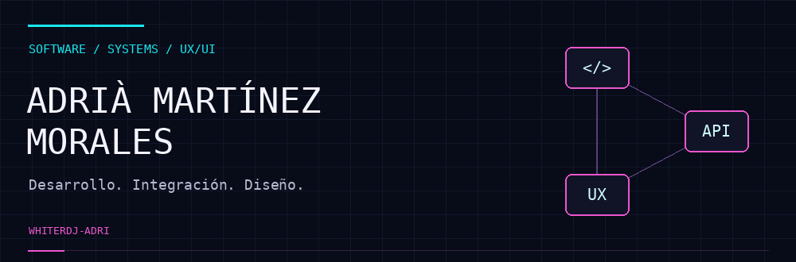

**Software Developer · Full Stack · UX/UI**

[LinkedIn](https://www.linkedin.com/in/adriamartinezmorales/) &nbsp; / &nbsp; [Explorar repositorios](https://github.com/whiterDJ-adri?tab=repositories)

---

### 01 / Del diseño al código

Soy desarrollador de software y titulado en Desarrollo de Aplicaciones Web, con una trayectoria previa en diseño web, diseño gráfico y UX/UI.

Trabajo en aplicaciones internas, integraciones mediante APIs REST y bases de datos. Me interesa comprender cómo encaja cada parte de una aplicación y adaptar las herramientas a las necesidades de cada proyecto.

### 02 / Una visión multidisciplinar

| Desarrollo | Integración | Diseño |
| :--- | :--- | :--- |
| Frontend y backend. Funcionalidades web y organización del código. | APIs REST, conexión entre sistemas y gestión de datos. | Interfaces, prototipos y experiencia de usuario. |

### 03 / Tecnologías y herramientas

**En mi trabajo**  
`JavaScript` `Node.js` `Express` `APIs REST` `SQL` `MariaDB`

**También utilizadas en proyectos personales y académicos**  
`React` `MongoDB` `Docker`

**Entorno y diseño**  
`Git` `GitLab` `Linux` `Figma`

### 04 / Cómo trabajo

- Comprender la necesidad y el contexto de cada funcionalidad.
- Conectar las decisiones técnicas con la experiencia de usuario.
- Organizar el código para facilitar su comprensión y mantenimiento.
- Aprender tecnologías y colaborar con perfiles diferentes.

Me interesa seguir profundizando en desarrollo web, automatización y entornos Linux, combinando aprendizaje y práctica.

---

**ADRIÀ MARTÍNEZ MORALES**  
Desarrollo de software · Integración de sistemas · Diseño UX/UI

[Conecta conmigo en LinkedIn](https://www.linkedin.com/in/adriamartinezmorales/)

