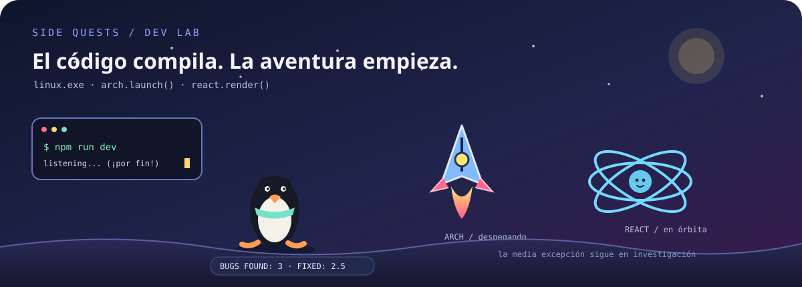

<div align="center">



### Desarrollo web, integraciones y alguna misión secundaria

Me gusta conectar las piezas de una aplicación: interfaz, servidor, datos y experiencia de uso.  
Si algo falla, primero miro los logs. Después miro por qué no había mirado los logs.

[LinkedIn](https://www.linkedin.com/in/adriamartinezmorales/) · [Mis proyectos](https://github.com/whiterDJ-adri?tab=repositories)

</div>

---

### El equipo de soporte

- **Linux** patrulla el sistema. Si el pingüino vuelve con una alerta, abro la terminal.
- **Arch** aporta el impulso. El despegue es rápido; el aterrizaje depende de la configuración.
- **React** mantiene todo en órbita y vuelve a renderizar justo cuando te habías levantado.
- **Node.js** se queda despierto atendiendo peticiones. A veces también se queda despierto el desarrollador.
- **Docker** intenta que “en mi máquina funciona” signifique lo mismo en la de los demás.

### Herramientas del taller

**Desarrollo e integración**  
`JavaScript` · `Node.js` · `Express` · `APIs REST`

**Interfaces y proyectos web**  
`React` · `Astro` · `UX/UI` · `Figma`

**Datos y entorno**  
`SQL` · `MariaDB` · `MongoDB` · `Docker` · `Linux / Arch` · `Git`

Trabajo en aplicaciones web, integraciones entre servicios y gestión de datos. También disfruto pensando cómo hacer que una interfaz sea clara antes de añadirle otra animación innecesaria.

### Misiones actuales

- Construir funcionalidades útiles de principio a fin.
- Entender mejor cómo se comunican las partes de una aplicación.
- Seguir aprendiendo sobre Linux, automatización y desarrollo web.
- Mantener los errores pequeños y los commits más pequeños todavía.

<details>
<summary>Diagnóstico rápido del laboratorio</summary>

```text
Servidor: despierto
Contenedores: hablando entre ellos
Bug inesperado: convertido en tarea
“Solo cambio una cosa”: nunca es solo una cosa
```

</details>

---

<div align="center">

¿Tienes una idea, un proyecto o una API con ganas de hablar con otra API?

[Conectemos en LinkedIn](https://www.linkedin.com/in/adriamartinezmorales/) · [Echa un vistazo a mis repositorios](https://github.com/whiterDJ-adri?tab=repositories)

</div>
